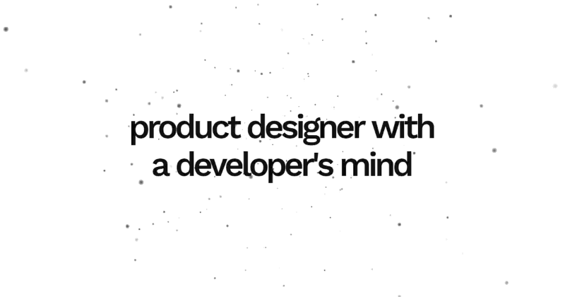

# OG Video Studio

A small browser tool for making the `og:video` for my portfolio: a twinkling 3D particle globe with a line of text over it, tweakable live and exported as an MP4.

[](assets/product-designer-with-a-developer-s-mind-og.mp4)

<sub>GIF preview, since GitHub won't play a repo MP4 inline. Click it for the full-quality [MP4](assets/product-designer-with-a-developer-s-mind-og.mp4).</sub>

## Run it

```bash
npm install
npm run dev
```

Open http://localhost:5173. Use Chrome or Edge for MP4 export.

## Using it

- **Settings icon** (top right) opens the panel. Each section collapses, and every change shows up in the preview straight away.
- **Replay** restarts the entry spin so you can see how the video will begin.
- **Download** renders the video and saves it as `<text>-og.mp4`.
- Drag the globe to spin it in the preview. Dragging is never recorded.
- Settings are remembered in your browser. **Copy values** copies every current setting as JSON, and **Reset** puts everything back to the defaults.

### Settings

| Section | What it controls |
| --- | --- |
| Colors | Background, text and particle colors |
| Text | Show/hide, content, size, letter spacing, weight, max width, line height, X/Y offset |
| Particles | Surface or volume distribution, count, sphere radius, particle size, depth sizing (min/max), seed |
| Motion | Loop, rotation speed, float intensity, twinkle and twinkle speed |
| Entry Spin | A fast opening spin that eases out (hidden while Loop is on) |
| Export | Total duration, 30/60 fps, resolution (1200×630 or 2400×1260), bitrate |

## How it works

### Rendering

Everything is drawn into a single canvas, which is both the preview and the video source, so the preview matches the export exactly.

1. The globe is drawn with WebGL on a hidden canvas. The shaders are ported from a Framer `ParticleSphere` component. Floating and twinkling are calculated on the GPU, and only the rotation is updated per frame in JavaScript.
2. That image is copied onto the visible canvas, and the name is drawn on top with the Canvas 2D API in Work Sans. The text is centered on its visible letters rather than its text box, with a correction for the extra spacing canvas adds after the last letter. Text wraps within the max width and is balanced like CSS `text-wrap: balance`: it keeps the fewest lines that fit but makes them as even as possible, and centres each line.

Particle positions come from a seeded random generator, so the same **Seed** always gives the same globe.

### Export

**Download** replays the animation from the start and renders it one frame at a time, stepping exactly 1/fps each frame. The frames are encoded to H.264 with the browser's WebCodecs API and packaged into an MP4 with [`mp4-muxer`](https://github.com/Vanilagy/mp4-muxer). Because it doesn't depend on real time, the video is perfectly smooth even if the preview stutters. It's usually faster than real time, too.

Browsers without WebCodecs fall back to recording the canvas in real time with `MediaRecorder`. That gives MP4 or WebM, depending on the browser.

### Seamless loop

With **Loop** on, the last frame flows straight back into the first. Total Duration is the loop length.

- **Float and twinkle** are rounded to a whole number of cycles per loop, so they end exactly where they began.
- **Rotation** keeps your normal Rotation Speed rather than being forced to a full 360° turn, so a short loop can still rotate slowly. The catch is that the globe ends up turned by some angle. To undo that, each particle quietly moves back by that angle at the moment its twinkle fades it to invisible. When Twinkle is off, a quick fade hides the move instead. By the last frame every particle is back where it started.

The Entry Spin is turned off in loop mode, because a spin that starts fast and slows down can't loop.

## Project structure

```
src/
  settings.ts                 every setting: type, default, and how the panel shows it
  engine/
    studio.ts                 render loop, canvas compositing, MP4 export
    gl.ts                     shaders, matrix maths, color parsing, seeded random
  components/
    SettingsPanel.tsx         collapsible panel (Motion for React)
    controls.tsx              slider, color, toggle, segmented and text inputs
  App.tsx                     preview stage, toolbar, wiring settings to the engine
assets/
  product-designer-…-og.mp4   the current exported video (6 s seamless loop)
  product-designer-…-og.gif   README preview of it (800px, 20 fps)
  deep-patel-og.mp4/.gif      the earlier "Deep Patel" version
```

To add a new setting, add it to `Settings`, `defaultSettings` and a section in `settings.ts`, then read it in `studio.ts`. The panel builds itself from that list.

## Stack

React, TypeScript, Vite, Motion for React, WebGL, WebCodecs and mp4-muxer.
